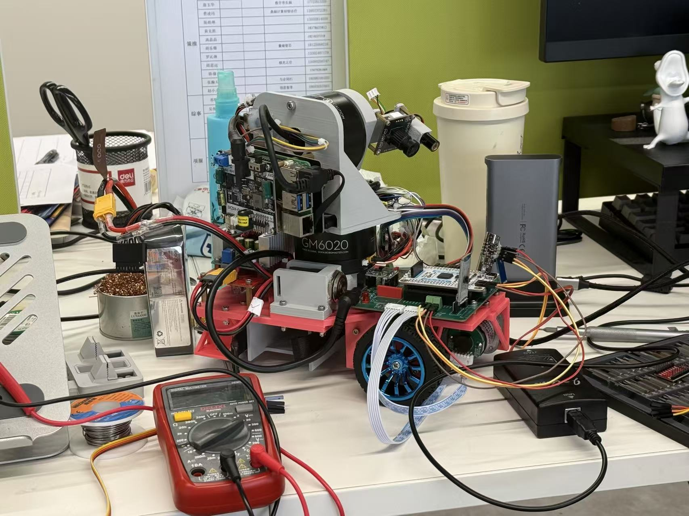
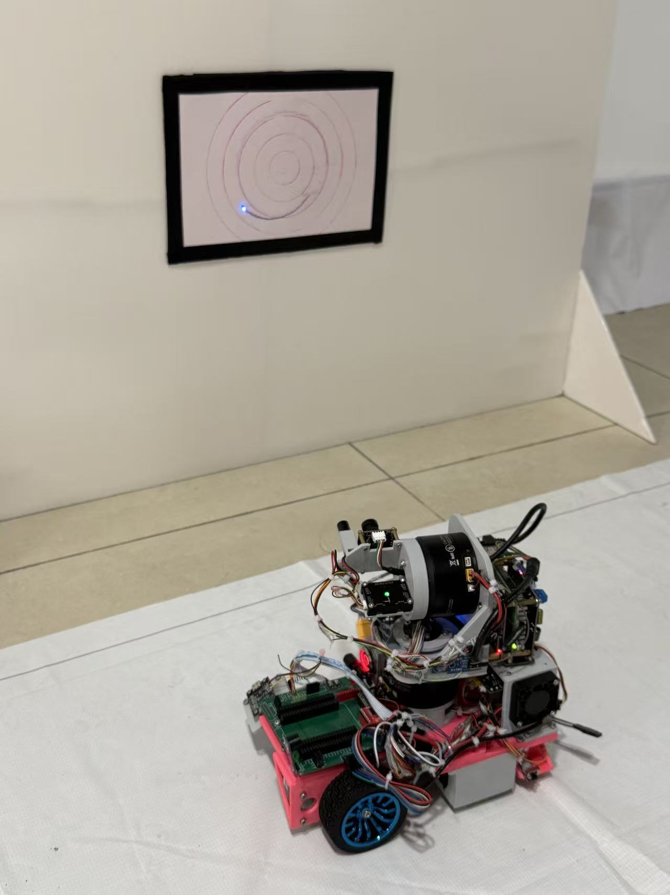
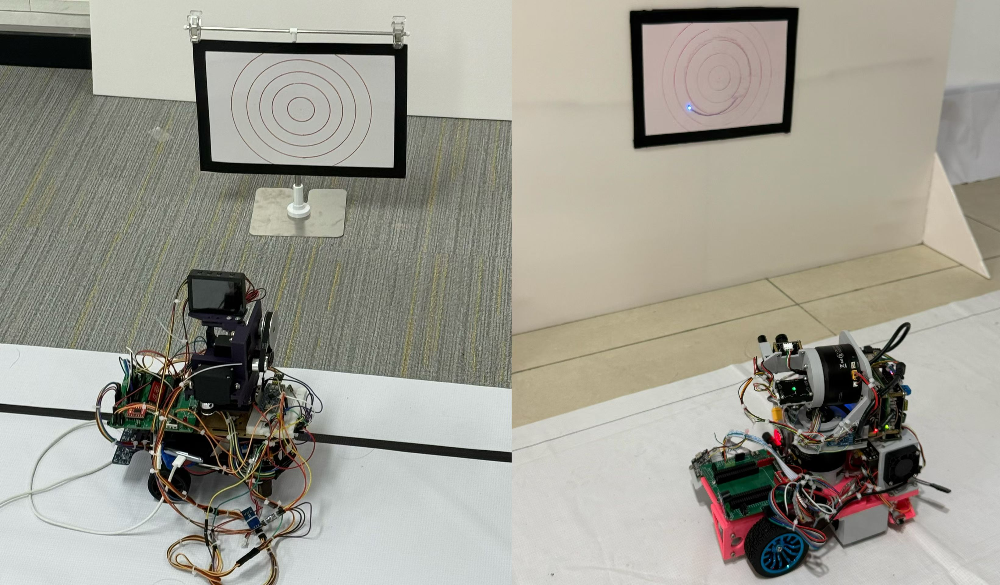

# Xingkun Cup 2026 - Autonomous Aiming Robot

A team robotics project for the 2026 Xingkun Cup Electronic Design Competition (Problem D). We built a mobile robot that follows a track while aiming a laser at a target and tracing a circular path on it.

## Key Features

- **Motion control:** TI MSPM0G3507 with encoder feedback, PID speed control, grayscale line tracking, and IMU heading control.
- **Computer vision:** Raspberry Pi 5 with Python and OpenCV for target detection, perspective correction, and circular trajectory generation.
- **Stabilized gimbal:** STM32-controlled GM6020 brushless motors with IMU feedback and a slip ring for continuous 360-degree rotation.
- **Custom hardware:** A SolidWorks-designed chassis, a custom controller expansion board, and a power distribution board.

## Photos

The assembled robot and a laser aiming test.

  
  

## Our Progress

Left: our robot for Problem E of the 2025 National Undergraduate Electronic Design Contest. Right: our 2026 Xingkun Cup robot. This comparison shows how much our engineering skills have grown, from mechanical design and hardware integration to vision and motion control.

## Repository

- [Car_TI_M0/](Car_TI_M0/): Chassis control firmware.
- [Pi5_CV/](Pi5_CV/): Computer vision code.
- [Report.pdf](Report.pdf): Full project report (Chinese).

## License

This project is licensed under the GNU General Public License v3.0 (GPL-3.0-only). See [LICENSE](LICENSE) for the full text.

Third-party components retain their original licenses.
